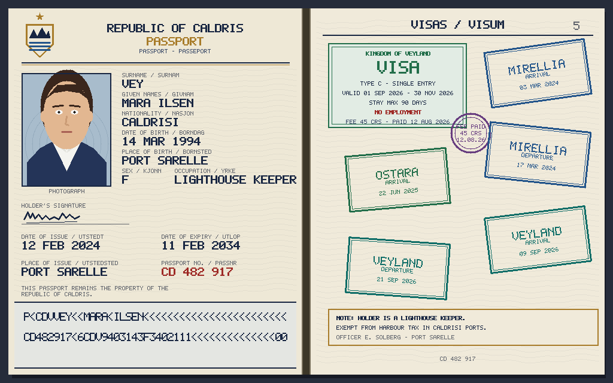

# Ember Passport Page

[](https://make.fun/c/the-passport-page-of-a-countr-2-20261121-0318)
[](https://make.fun/c/the-passport-page-of-a-countr-2-20261121-0318)
[](https://make.fun/c/the-passport-page-of-a-countr-2-20261121-0318)

An invented passport spread for the **Republic of Caldris** — a northern
island republic that does not exist — drawn entirely in code for the make.fun
[the-passport-page-of-a-countr-2-20261121-0318](https://make.fun/c/the-passport-page-of-a-countr-2-20261121-0318)
bounty.



## The document in the image

- **Data page** — Mara Ilsen Vey, lighthouse keeper of Port Sarelle, born
  14 Mar 1994. Passport CD 482 917, issued 12 Feb 2024 in Port Sarelle,
  expiring 11 Feb 2034. Bilingual field labels (English / Caldric), a
  hand-drawn coat of arms, a vector portrait, and a machine-readable zone
  with real ICAO 9303 check digits.
- **Visa page** — a Veyland Type C single-entry visa (valid 01 Sep – 30 Nov
  2026, stay max 90 days, **no employment**, fee 45 CRS paid 12 Aug 2026)
  with its purple fee stamp, plus arrival and departure stamps from
  Mirellia, Ostara and Veyland. Every stamp is dated after the passport's
  issue, in travel order.
- **The telling detail** — the holder is a lighthouse keeper, exempt from
  harbour tax in Caldrisi ports (Officer E. Solberg, Port Sarelle).

## How it is made

`main.ts` (Node 22, standard library only) plots every pixel itself into a
1024x640 PNG: a hand-built 5x7 bitmap font, a vector-drawn portrait and coat
of arms, rotated entry/exit stamps, guilloche security waves, and a
deterministic PNG encoder. No network, no external images. Run it with:

```sh
node main.ts
```

It writes `/output/entry.png` (1024x640, ~28 KB), byte-identical on every run.

## License

MIT — see [LICENSE](LICENSE).
